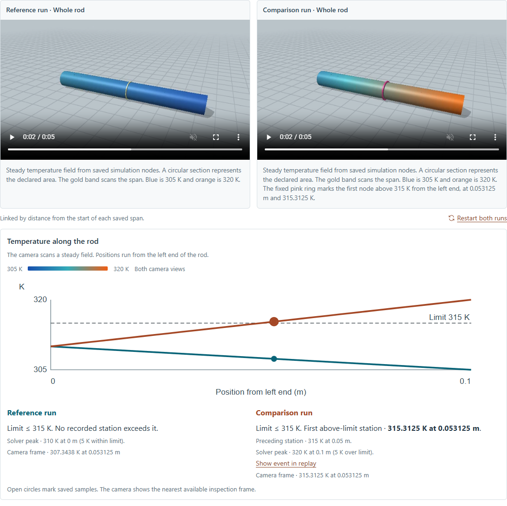

# When does the enclosure take the rod above 315 K?

The reference enclosure is at 300 K. Changing only the fluid at the right end to 330 K raises the hottest point on the rod from **310 K to 320 K**. The passing and failing camera replays use the same temperature colors. The recorded field reaches 315 K at 50 mm from the left end. Its first saved station above the limit is at 53.125 mm and reads 315.3125 K. [Open the paired replay on the pilot PC](http://127.0.0.1:8000/#/projects/project_e1e4334665c14257ba629a8826a287bb/analysis?batch=suite_4cfbbad6a49f46a6a6028a21d0f99dd3&run=run_8b1897cb2a5f42c198c3c6f966a0ee1a&reference=run_e4e2971c516b4c7cbdc398b139e9cca3) · [Solver and decoded camera readings](comparison.json)

1. Open a **Heat & cooling** project. In **Discover scenarios**, import the [reference model](reference.json) and choose **Import and run reference**.
2. Select that reference and enter “The enclosure reaches 330 K. What happens to the component at equilibrium?” Choose **Generate and run test cases**. Read the peak temperature, then choose **Compare replays → Show event in replay**.
3. Start a new scenario batch with the same reference. Enter “The fan runs at 2000 RPM. How does that affect the right end?” The workbench saves a question about the installed fan’s speed-to-cooling relationship. Supply the RPM, corresponding film coefficient and calibration source to test that operating point. [Saved calibration question](http://127.0.0.1:8000/#/projects/project_e1e4334665c14257ba629a8826a287bb?tab=scenarios&generation=discovery_4ff8b0acae52430f936acb62ec88363f)

This is an illustrative steady-state experiment. The 100 mm rod has insulated sides, zero internal heat generation and a 310 K left end. Conductivity is 10 W/(m·K) and the end-face film coefficient is 100 W/(m²·K). The conduction and convection resistances are equal. The right surface therefore sits halfway between the left-end and fluid temperatures in each run, giving 305 K and 320 K respectively. The temperature varies linearly between the ends. The moving camera scans these spatial results. [Convective boundary equation](https://doc.comsol.com/6.3/doc/com.comsol.help.comsol/comsol_ref_heattransfer.30.30.html)
